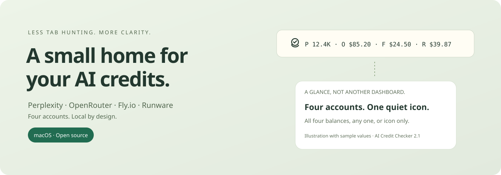
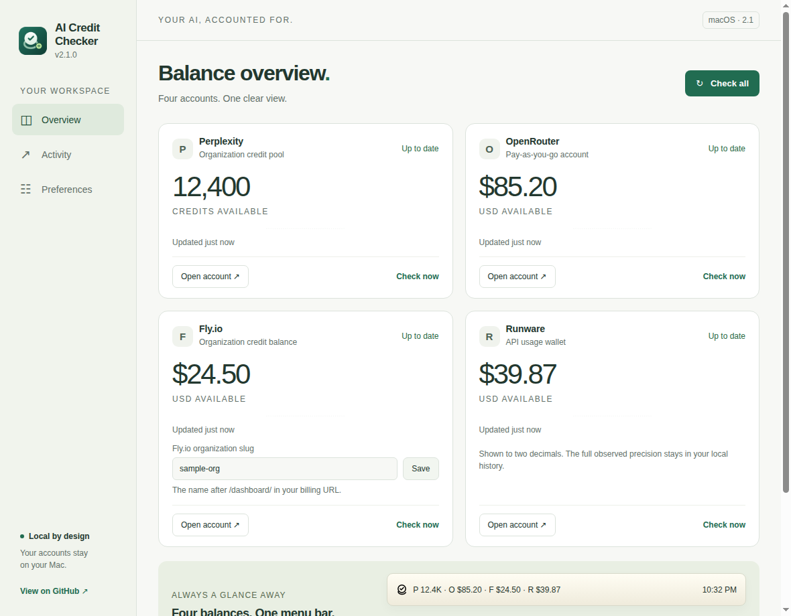
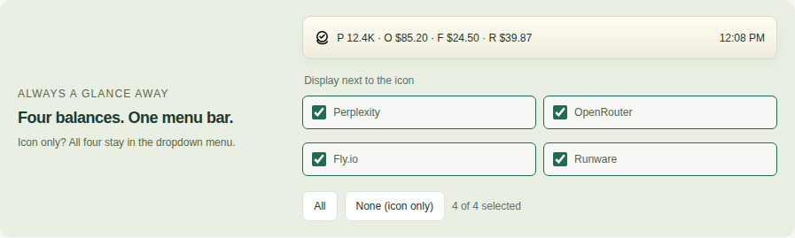

<div align="center">
  
  <h1>AI Credit Checker</h1>
  <p>Your AI credits. Quietly in your menu bar.</p>
  <p>
    <a href="https://github.com/paulfxyz/ai-credit-checker/releases/latest"></a>
    <a href="LICENSE"></a>
    
    
    <a href="https://github.com/paulfxyz/ai-credit-checker/actions/workflows/ci.yml"></a>
  </p>
  <p><a href="https://github.com/paulfxyz/ai-credit-checker/releases/latest">Download for Mac</a> · <a href="INSTALL.md">Install guide</a> · <a href="CHANGELOG.md">Changelog</a> · <a href="PRIVACY.md">Privacy</a> · <a href="CONTRIBUTING.md">Contribute</a></p>
  
</div>

## Your balances, without the tab hunt

AI Credit Checker is a menu-bar app for Apple Silicon Macs. It brings Perplexity organization credits and OpenRouter, Fly.io and Runware USD balances into one 2×2 dashboard.

Sign in to each provider's real website inside the app, then choose which counters to show beside the icon. The app reads labelled balances and saves timestamped observations locally; no API keys, browser extension, hosted relay or AI inference are required.

## Install or update

1. Download **AI-Credit-Checker-2.1.4-macOS-arm64.zip** from the [latest release](https://github.com/paulfxyz/ai-credit-checker/releases/latest). If you are replacing an existing installation, quit it first.
2. Extract the ZIP and move **AI Credit Checker.app** to Applications.
3. For Fly.io, save the organization slug from your billing URL. Use **Open account** to sign in to each provider you want to track, then **Check now** to verify its balance.
4. Select your menu-bar counters and a **10, 30 or 60-minute** balance-check interval. Close the provider windows and enable automatic checks.

Already on **2.1.1 or later**? Use **Preferences → Check for updates → Download & restart** instead. Keep the app's Application Support directory to retain your sessions, preferences and history.

**Community build: ad-hoc signed, not Developer ID signed or notarized.** macOS may require approval in Privacy & Security. Intel builds are not provided; do not disable Gatekeeper or management policies to install. Read the [installation and troubleshooting guide](INSTALL.md) if opening or updating fails.



Screenshots use synthetic data captured from the running Electron app, not real account balances. The menu-bar strip inside the window is a preview, not a capture of the native macOS menu bar.

## What you get

- **Choose your counters:** Independently select any combination of the four providers, or use All / None (icon only). The native dropdown always includes all four balances.
- **A 2×2 overview:** Configure your Fly.io organization and open or check each provider independently.
- **Precision where it matters:** The dashboard shows the full credit count and USD to two decimal places. Runware's full observed precision stays in local history. Compact menu-bar credit counts use one decimal and truncate rather than round upward.
- **Background checks:** Choose every 10, 30 or 60 minutes while the app is running and your Mac is awake. Automatic collection starts for accounts with a previous observation; visible account windows are skipped so checks do not interrupt sign-in.
- **Clear freshness:** Failed readings become `∞`, meaning unavailable, never unlimited. Age-based staleness follows twice your selected interval (20, 60 or 120 minutes), so hourly checks do not appear stale between scheduled runs.
- **Local history:** Keep up to 2,000 check records, filter by provider and export JSON without cookies or passwords.
- **Mac integration:** A monochrome menu-bar icon, optional launch at login, and refresh after wake when automatic balance checks are enabled.



## Four balances, two different units

| Provider | What is collected | What is not collected |
| --- | --- | --- |
| Perplexity | Available organization Computer credit pool from the signed-in Usage page | Personal-plan allowances, credits already used, refill amounts, or a USD estimate |
| OpenRouter | Available account balance in USD from the signed-in Credits page | A model token count or another organization's balance |
| Fly.io | Credit Balance in USD for the configured organization | Invoice totals, active-credit usage or the Buy Credits amount |
| Runware | Inference credits Available balance in USD, with full precision retained in history | Monthly spend, top-up transactions or payment details |

The collector targets [Perplexity organization Usage](https://www.perplexity.ai/account/org/credits-usage), [OpenRouter Credits](https://openrouter.ai/settings/credits), the billing page for your configured [Fly.io organization](https://fly.io/dashboard), and [Runware Billing](https://runware.ai/settings/billing). Availability depends on your account role, the provider's website and successful login. An ordinary personal Perplexity account without organization-pool access is not covered by this implementation.

The current Perplexity parser recognizes the English labels **Available org credits**, **Available organization credits** and **Available organisation credits**. It deliberately refuses an ambiguous reading rather than guessing from another number on the page.

## Updates without surprise restarts

App updates and balance checks run on separate schedules. The packaged app checks the public [GitHub Releases](https://github.com/paulfxyz/ai-credit-checker/releases) feed about 15 seconds after launch and every **six hours**; this is enabled by default and can be disabled in Preferences.

- **Manual check:** Available in Preferences and the native menu. No new version means no download.
- **Confirmed installation:** **Download & restart** asks before downloading or quitting. The installer checks the GitHub asset's SHA-256 digest, bundle identifier, version, arm64 executable and code-signature integrity.
- **Recovery:** The previous app is retained. File-replacement or open-command failures attempt rollback; later app crashes are not automatically detected.
- **Limits:** The app must be in a writable folder and keep its original name. No administrator privileges or macOS security bypass is used. Ad-hoc integrity verification is not an Apple-verified developer identity or notarization.

The first upgrade from 2.0 or 2.1.0 must be installed manually because those versions have no updater. See [update requirements, backups and logs](INSTALL.md#app-updates-via-github) for details.

## Local data and security

```text
Provider website inside an isolated Chromium session
                         │
              Read the available-balance label
                         │
              Validate amount, unit and scope
                         │
             Local timestamped observations
                         │
         Dashboard + history + native menu bar
```

Each provider uses a separate persistent browser session. Remote pages have no Node access or privileged preload bridge; renderer sandboxing, context isolation and web security stay enabled. There is no undocumented API probing, browser-policy modification, cookie import from another browser, or automated verification bypass.

Observations, preferences and browser sessions stay in the app's local data directory. JSON exports omit cookies and passwords but still contain balances and, for Fly.io, the organization slug, so review exports before sharing.

“Local” does not mean offline: provider pages load their own resources, and update checks contact GitHub. The app has no project-operated data relay or telemetry integration; see [Privacy](PRIVACY.md) and [Security](SECURITY.md).

## What to expect

- **Website collection is not an official balance API.** A provider can change its wording, markup or sign-in requirements and break extraction.
- **Login support varies.** Some SSO or verification flows may reject embedded browsers. We do not bypass those restrictions.
- **Closing the window is not quitting.** The app stays in the menu bar. Use Quit to stop it.
- **Sleeping is sleeping.** The app does not keep your Mac awake. On wake it attempts a refresh if background checks are enabled and the account window is not visible.
- **Screen space matters.** Four counters may not fit every menu bar. Choose a subset or icon-only mode; the dropdown still contains all four balances.

## From the original proof of concept

This is a desktop-only successor to Credit Monitor POC. The earlier Stream Deck and Comet-extension experiments are not part of this repository.

On first launch, the app can automatically import numeric observation history from the original **Credit Monitor POC** data directory if it still exists. It does not copy browser cookies or passwords. Imported accounts are marked as requiring sign-in, not falsely shown as connected. See [migration instructions](INSTALL.md#moving-from-credit-monitor-poc).

## Develop and test

Requires Node.js 22.12 or later.

```sh
git clone https://github.com/paulfxyz/ai-credit-checker.git
cd ai-credit-checker
npm ci
npm start
```

```sh
npm test
npm run test:smoke
npm run package:mac
```

Release maintainers can use `bash scripts/package-release.sh` to produce an ad-hoc-signed archive and checksum. On macOS it uses the built-in `codesign`; cross-platform packaging requires `rcodesign` on PATH or an explicit `RCODESIGN` path. This is not a notarization workflow.

On Linux, run the Electron smoke test with `xvfb-run -a npm run test:smoke`. The test-only Linux launch uses `--no-sandbox` in the isolated test process; the packaged Mac app does not use that flag.

The suite covers parsing, all 16 counter selections, cadence-aware freshness, session isolation, persistence, updater validation and single-scroll layout at default and minimum window sizes. On a Mac with build tools, `node tests/updater-mac.cjs` exercises replacement and launch of a harmless signed fixture app; the release workflow runs this test before publishing.

The original user confirmed all four live providers working in 2.1.0. Automated tests use synthetic pages and cannot establish sign-in compatibility, native menu-bar fit or Gatekeeper approval on every Mac; see the versioned [validation notes](docs/VALIDATION.md).

## Open source, honestly

### Disclaimer: 100% vibe coding

Built by **Paul Fleury** with AI assistance. I am an entrepreneur building useful software with AI, not presenting this as the work of a traditional full-time software engineer.

The code is open so it can be inspected, challenged and improved. Tests and explicit limitations matter more than claims of perfection. Treat this as a community utility, not an authoritative billing ledger.

AI Credit Checker is an independent project, not affiliated with or endorsed by Perplexity, OpenRouter, Fly.io, Runware, Apple or Electron. Provider names identify the accounts supported by the tool; the app and menu-bar artwork is original.

## License

MIT. The source code and original artwork in this repository are covered by [LICENSE](LICENSE). Bundled dependencies retain their own licenses.
